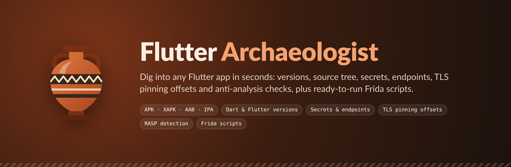
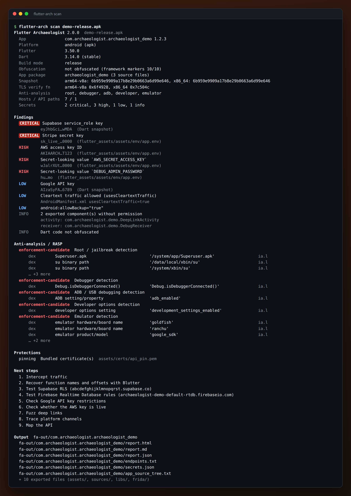
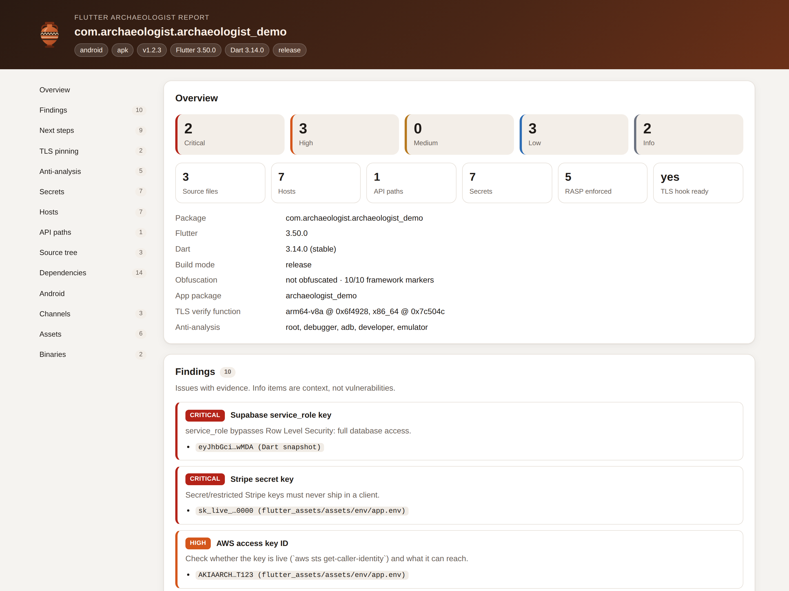
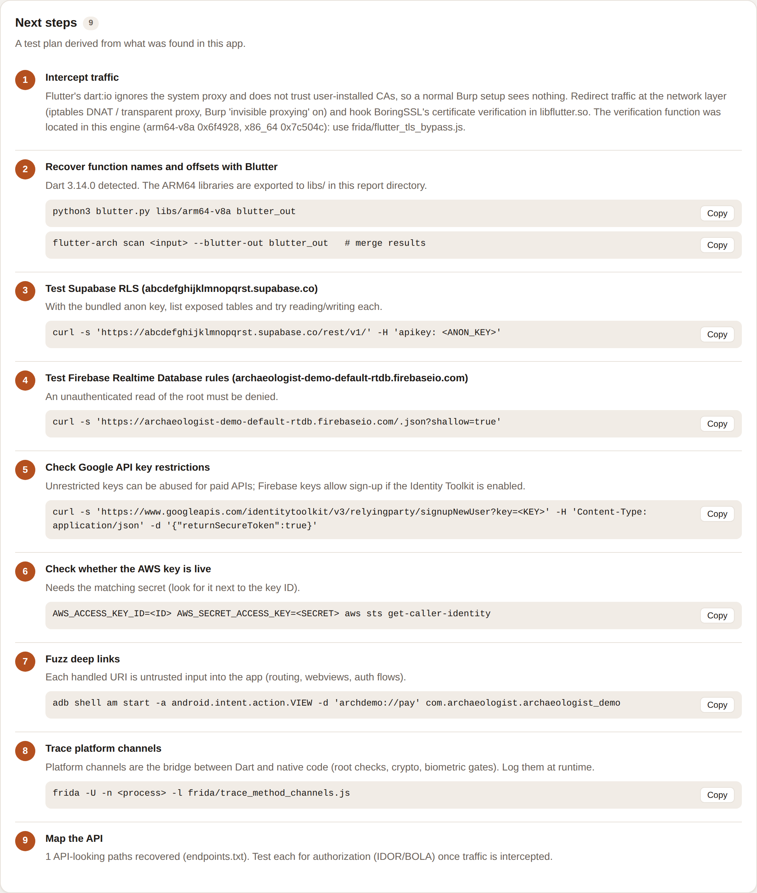
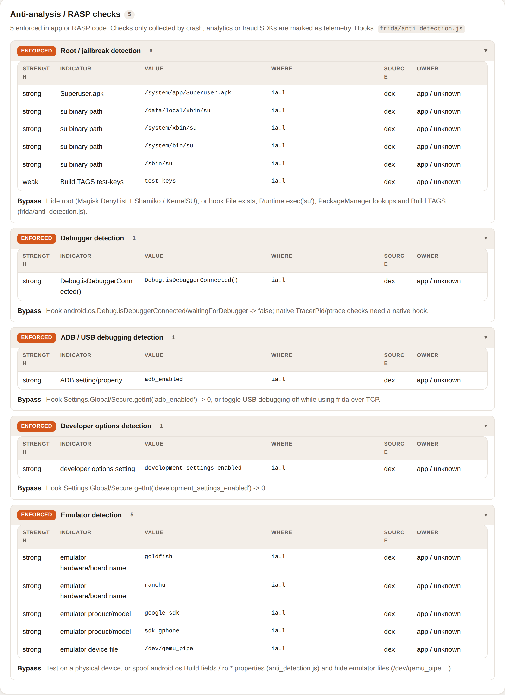
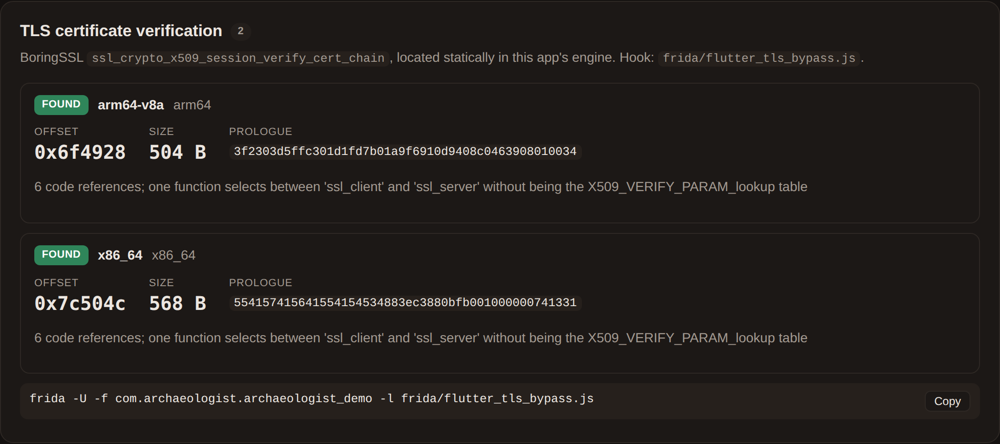
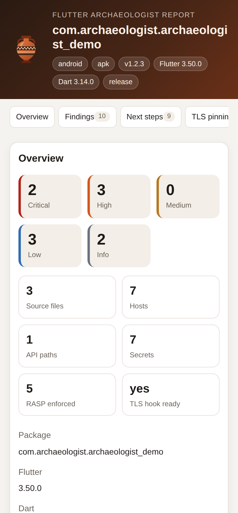
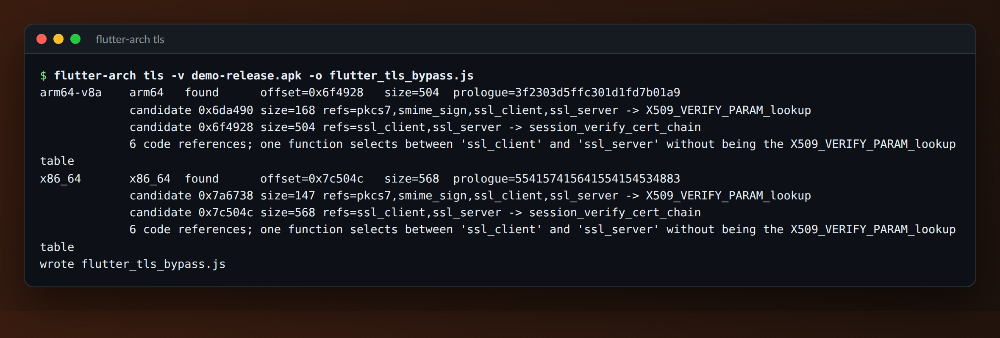
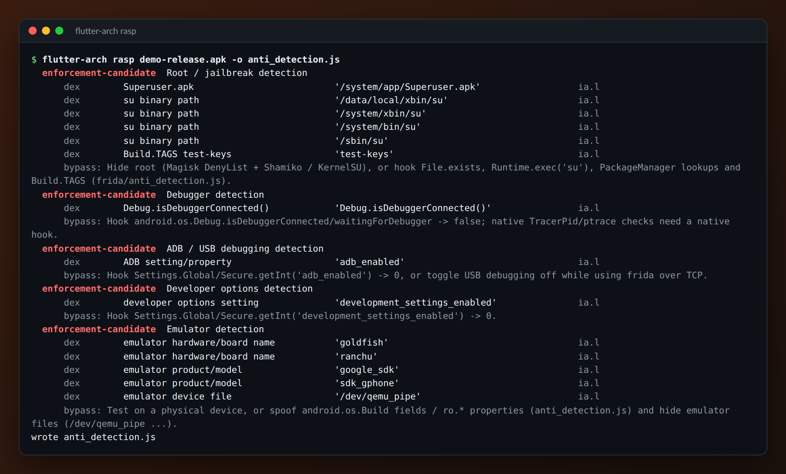
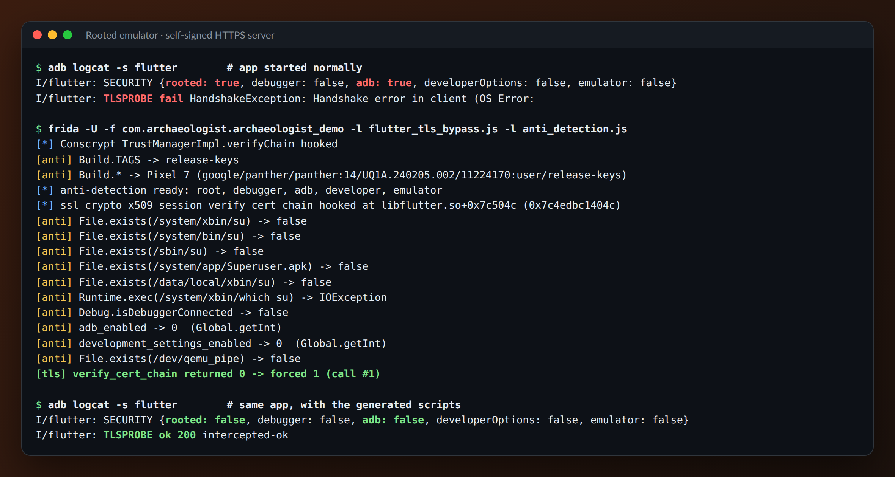

<p align="center">
  
</p>

<p align="center">
  <b>Recon and attack-surface mapping for Flutter mobile apps.</b><br>
  Point it at an APK or IPA and get, in about a second, what you need to start testing:
  versions, build mode, the app's own source tree, endpoints, secrets, TLS pinning offsets,
  anti-analysis checks and ready-to-run Frida scripts.
</p>

<p align="center">
  
  
  
  
  
</p>

---

Flutter apps are opaque to the usual mobile tooling. jadx only shows a thin Java shell, the Dart
code is compiled into `libapp.so`, traffic ignores your proxy and user CAs, and `strings` returns
tens of thousands of lines of noise. Flutter Archaeologist does the first hour of manual work on a
Flutter target for you and tells you what to do next.

<p align="center"></p>

## Highlights

- **Versions and build facts.** Exact Dart SDK version from the engine, mapped to the Flutter
  release that shipped it. Snapshot hash, release/profile/debug, and whether `--obfuscate` was used.
- **The app's own source tree.** Every `package:<app>/…` library path, which shows the app's
  architecture. Debug builds go further: the complete Dart source code is recovered from
  `kernel_blob.bin`.
- **Exact Dart strings.** Snapshot string literals are decoded from Dart's own serialisation
  format, not guessed with `strings`, so endpoints, keys and UI text come out whole.
- **Secrets and endpoints.** AWS, Stripe, Google, GitHub, Slack, SendGrid, Azure, OpenAI/Anthropic
  keys, private keys, credentials in URLs, JWTs (Supabase `service_role` vs `anon` decoded),
  `.env` files in `flutter_assets`, hosts grouped by service, and relative API paths.
- **TLS pinning offset found statically.** Locates BoringSSL's certificate verification function
  inside *this* app's `libflutter.so` and writes a Frida hook for it.
- **Anti-analysis / RASP detection.** Root, Frida, debugger, ADB, developer options, emulator,
  overlay, FLAG_SECURE, device lock, mock location, VPN, Play Integrity and commercial RASP SDKs,
  each attributed to the class that performs the check. Crash, analytics and fraud SDK telemetry
  is separated from real protections.
- **Generated Frida scripts.** TLS bypass (Dart and Java layers), anti-detection hooks,
  platform-channel tracer with result overrides, and a connection logger.
- **Readable reports.** A self-contained HTML report, plus Markdown and JSON for pipelines.

## Install

```bash
git clone https://github.com/HCIBO/Flutter-Archaeologist.git
cd Flutter-Archaeologist
pip install .
flutter-arch --help
```

Pure Python 3.10+, no third-party dependencies.

## Usage

```bash
flutter-arch scan app.apk                                  # full analysis + report
flutter-arch scan base.apk split_config.arm64_v8a.apk      # split APKs
flutter-arch scan ./pulled-apks/                           # a directory of splits
flutter-arch scan app.xapk | app.apks | app.aab | app.ipa | libapp.so

flutter-arch info app.apk                                  # quick: Flutter? versions? obfuscated?
flutter-arch tls  app.apk -o flutter_tls_bypass.js -v      # TLS verify offset + Frida hook
flutter-arch rasp app.apk -o anti_detection.js             # anti-analysis checks + hooks (any APK/IPA)

flutter-arch scan app.apk --json --no-report               # machine-readable output
flutter-arch scan app.apk --fail-on high                   # exit 3 on high/critical findings (CI)
flutter-arch update-versions                               # refresh the Dart -> Flutter version table
```

Secrets are masked in reports by default (`--show-secrets` disables masking). `secrets.json`
always contains the full values.

## The HTML report

Each scan writes a single offline `report.html`: severity overview, findings with evidence, a
test plan with copyable commands, TLS offsets, anti-analysis checks, secrets, hosts, API paths,
source tree, dependencies and manifest. It supports light/dark mode, filtering and mobile layouts.

<p align="center"></p>

<table>
<tr>
<td width="50%"></td>
<td width="50%"></td>
</tr>
<tr>
<td></td>
<td align="center"></td>
</tr>
</table>

## TLS pinning: offsets found statically

<p align="center"></p>

This automates [NVISO's technique](https://blog.nviso.eu/2019/08/13/intercepting-traffic-from-android-flutter-applications/).
BoringSSL's `ssl_crypto_x509_session_verify_cert_chain` calls
`X509_STORE_CTX_set_default(ctx, ssl->server ? "ssl_client" : "ssl_server")`. The tool proceeds in five steps:

1. finds both C strings in `libflutter.so`;
2. resolves every code reference to them (arm64 `ADRP`+`ADD`, x86_64 `LEA [rip+disp]`);
3. maps each reference to its containing function using the `.eh_frame_hdr` unwind table;
4. discards `X509_VERIFY_PARAM_lookup`, which references the same names but `strcmp`s them
   against its table (recognised by its `pkcs7` / `smime_sign` references);
5. writes `flutter_tls_bypass.js`, which checks the bytes at the offset before hooking (it refuses
   to patch a different engine build) and forces the function to succeed.

dart:io runs every certificate check inside that function: trusted roots, `SecurityContext`
pinning and `badCertificateCallback`. Plugins that wrap native SDKs (FlutterFire, Stripe,
cronet_http, WebViews) use the platform TLS stack instead, so the script also hooks Conscrypt's
`TrustManagerImpl` and `okhttp3.CertificatePinner`, and the report lists which plugins need it.

You still need to route traffic to your proxy (iptables / transparent proxy with Burp's invisible
proxying), because Flutter ignores the system proxy.

## Anti-analysis / RASP checks

<p align="center"></p>

The tool searches the DEX bytecode, the Dart snapshot, native libraries, the manifest (`<queries>`
for root apps, overlay and screen-capture permissions) and the pub packages.

- **Each DEX hit is attributed to its class.** A small DEX parser walks the method's bytecode to
  confirm the hit is a real `const-string` / `invoke-*` instruction.
- **Telemetry is kept apart from protection.** Hits inside crash, analytics or fraud SDKs
  (Crashlytics, Play services, Sentry, Stripe…), including R8-renamed classes recognised by their
  marker strings, are labelled *telemetry*. Without this, every Firebase app would appear to
  "detect root".

`anti_detection.js` turns on hooks only for the categories found. It covers Settings
(`adb_enabled`, `development_settings_enabled`), `Debug.isDebuggerConnected`, su/emulator
`File.exists`, `Runtime.exec("su")`, root-package lookups, `Build.*` / `SystemProperties`
spoofing, `/proc/self/maps` reads, mock location, keyguard, `FLAG_SECURE`, VPN transport and
installer source.

## Verified on a device

The demo app in [`examples/demo_app`](examples/demo_app) performs its own root, ADB, debugger and
emulator checks and calls a self-signed HTTPS server. This is the same app on a rooted emulator,
first without and then with the two generated scripts:

<p align="center"></p>

## Output

```
fa-out/<app id>/
├── report.html / report.md / report.json
├── endpoints.txt          hosts, URLs, API paths
├── secrets.json           unmasked values
├── app_source_tree.txt    reconstructed lib/ layout
├── strings.txt            every Dart string literal
├── classes.txt            class-like identifiers
├── assets/                .env / config / certificate files from flutter_assets
├── sources/               full Dart sources (debug builds)
├── libs/arm64-v8a/        libapp.so + libflutter.so, ready for Blutter
└── frida/
    ├── flutter_tls_bypass.js
    ├── anti_detection.js
    ├── trace_method_channels.js
    ├── net_recon.js
    ├── flutter_tls_bypass_hint.md
    └── blutter_hooks.js   (with --blutter-out)
```

## Frida scripts

| Script | What it does |
|---|---|
| `flutter_tls_bypass.js` | Forces the located BoringSSL verify function to succeed (prologue-checked) and accepts any chain in Conscrypt / OkHttp. |
| `anti_detection.js` | Neutralises the Java-level environment checks detected in the app. |
| `trace_method_channels.js` | Logs every platform-channel call and the native reply (`[dart->native] channel :: method(args)`). `OVERRIDES` lets you answer a call yourself, e.g. make a root check return `false`. It hooks `FlutterJNI`, whose names survive R8, and works in spawn and attach mode. |
| `net_recon.js` | Logs every `connect()` (IPv4/IPv6) so you can see which hosts the engine really talks to. |
| `blutter_hooks.js` | Entry hooks for security-relevant Dart functions located by Blutter. |

All scripts work with Frida 16 and 17.

## Going deeper with Blutter

Flutter Archaeologist does not decompile Dart functions. [Blutter](https://github.com/worawit/blutter)
does, for ARM64. The two tools are meant to be used together:

```bash
flutter-arch scan app.apk                              # exports libs/arm64-v8a/
python3 blutter.py fa-out/<app>/libs/arm64-v8a blutter_out
flutter-arch scan app.apk --blutter-out blutter_out    # merge
```

The merge indexes the app's functions (class, name, address, size), flags security-relevant ones,
scans Blutter's object pool for secrets and generates `frida/blutter_hooks.js`.

## How it works

- **Snapshot location.** The tool parses ELF and Mach-O symbols (`_kDartIsolateSnapshotData`, or
  `_kDartSnapshotData` in the merged layout introduced by Dart 3.14). For stripped binaries it
  falls back to the snapshot magic and header validation.
- **Strings.** Dart serialises snapshot strings back to back, each prefixed by a varint
  `(length << 1) | is_two_byte`. Walking these chains yields every literal with exact boundaries,
  including UTF-16 text.
- **Versions.** The Dart version string embedded in `libflutter.so` / `Flutter.framework` is
  matched against the official Flutter release index (bundled, refreshable).
- **Debug builds.** The string table of each kernel component is located by validating the
  candidate offsets in the component index, and sources are read from the source table.
- **Android metadata.** A built-in binary-XML decoder reads `AndroidManifest.xml` and `res/xml/*`.

## Limitations

- No function-level decompilation (use Blutter).
- Obfuscated builds hide class names and library URIs. String literals, URLs, secrets and assets
  are still recovered.
- TLS offsets are located for arm64 and x86_64 Android engines. armeabi-v7a and iOS engines are
  not supported yet.
- `anti_detection.js` covers Java-level checks. Native checks of commercial RASP SDKs are
  reported but not bypassed.
- AAB manifests are protobuf-encoded and are not parsed.
- The IPA path is covered by synthetic test fixtures.

## Development

```bash
pip install -e '.[dev]'
pytest                                              # unit tests
FLUTTER=/path/to/flutter tools/build_fixtures.sh    # builds the demo app in four flavours
pytest                                              # now also runs the integration tests
```

`tools/build_fixtures.sh` builds `examples/demo_app` as release, obfuscated, debug and AAB. Its
fake secrets are assembled at build time, so none of them is committed.

## License

[MIT](LICENSE)

## Legal

For security testing of applications you own or are authorised to assess.
